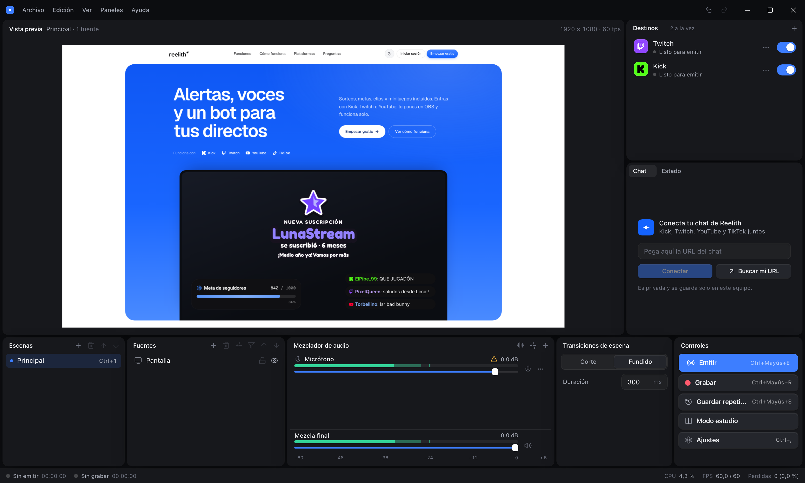
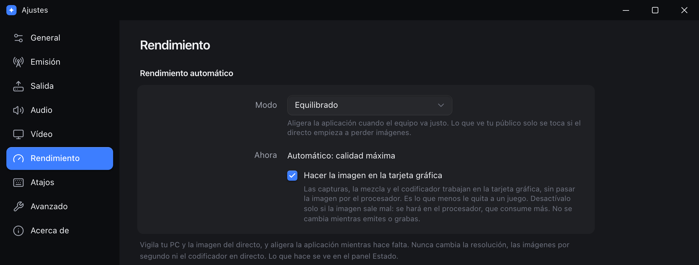

<p align="center">
  
</p>

<h1 align="center">Reelith Studio</h1>

<p align="center">
  Graba y emite en directo con un estudio pensado para que tu juego siga fluido.<br>
  Escenas, alertas de Reelith y varias plataformas a la vez: Twitch, Kick, YouTube y TikTok.
</p>

<p align="center">
  <a href="https://github.com/ReelithLabs/reelith-studio-releases/releases/latest"></a>
  
  
  
  <a href="#privacidad"></a>
</p>

<p align="center">
  <a href="https://github.com/ReelithLabs/reelith-studio-releases/releases/latest/download/Reelith-Studio-Setup-x64.exe"><strong>Descargar para Windows</strong></a>
  &nbsp;·&nbsp;
  <a href="https://github.com/ReelithLabs/reelith-studio-releases/releases/latest/download/Reelith-Studio-macOS-arm64.dmg"><strong>Descargar para Mac</strong></a>
  &nbsp;·&nbsp;
  <a href="https://github.com/ReelithLabs/reelith-studio-releases/releases">Todas las versiones</a>
  &nbsp;·&nbsp;
  <a href="https://reelith-platform.xyz">reelith-platform.xyz</a>
</p>

<p align="center">
  
</p>

> [!NOTE]
> **Reelith Studio está en beta.** Ya puedes grabar y emitir con él, y lo seguimos mejorando en cada versión: más rendimiento y las ideas que nos mandes. Si algo no va bien, [avísanos](https://github.com/ReelithLabs/reelith-studio-releases/issues/new/choose) y lo arreglamos.

## Qué es

Reelith Studio es una aplicación de escritorio para grabar y emitir en directo. Tiene lo que esperas de un programa de streaming (escenas, fuentes, filtros, mezclador de audio y modo estudio), pero viene pensada para que la tengas lista en minutos: conoce tu equipo, te propone los ajustes que aguanta y hace el trabajo pesado en la tarjeta gráfica para quitarle lo mínimo a tu juego.

Lo hacemos en [Reelith](https://reelith-platform.xyz), la plataforma de alertas, voces y bot para streamers. Si ya la usas, tus alertas, tu chat y tus metas se añaden a tus escenas como páginas web.

## Descargar

| Sistema | Descarga |
| --- | --- |
| Windows 10 (versión 1903 o posterior) y Windows 11, de 64 bits | **[Reelith-Studio-Setup-x64.exe](https://github.com/ReelithLabs/reelith-studio-releases/releases/latest/download/Reelith-Studio-Setup-x64.exe)** |
| macOS 14 Sonoma o posterior, en un Mac con Apple Silicon (M1 o posterior) | **[Reelith-Studio-macOS-arm64.dmg](https://github.com/ReelithLabs/reelith-studio-releases/releases/latest/download/Reelith-Studio-macOS-arm64.dmg)** |

Cada versión tiene su página en [Versiones](https://github.com/ReelithLabs/reelith-studio-releases/releases), con lo que cambia y la huella SHA-256 de cada instalador.

## Instalar en Windows

1. Descarga el instalador y ábrelo.
2. Si aparece «Windows protegió su PC», pulsa **Más información** y después **Ejecutar de todas formas**.
3. Sigue los pasos. Al terminar, abre Reelith Studio desde el menú Inicio.

> **¿Por qué avisa Windows?** SmartScreen avisa de los programas que aún no llevan firma digital de editor o que todavía tienen pocas descargas. El aviso no significa que el programa tenga nada malo. Si quieres estar seguro de que tu archivo es exactamente el que publicamos, compruébalo con su huella (lo explicamos [más abajo](#comprobar-que-el-instalador-es-el-original)).

Lo que hace el instalador, y nada más:

- Instala Reelith Studio solo para tu usuario. No pide permisos de administrador.
- Lleva dentro todo lo que la aplicación necesita (GStreamer y el runtime de Visual C++) en su propia carpeta. No cambia nada de otros programas: si tienes OBS o GStreamer instalados, siguen igual.
- Si a tu Windows le falta Microsoft Edge WebView2 (Windows 11 ya lo trae), lo descarga de Microsoft y lo instala.

Para desinstalarlo: **Configuración › Aplicaciones › Aplicaciones instaladas › Reelith Studio › Desinstalar**.

## Instalar en Mac

1. Descarga el DMG, ábrelo y arrastra **Reelith Studio** a la carpeta **Aplicaciones**.
2. Abre Reelith Studio desde Aplicaciones. La primera vez, macOS avisa de que no puede comprobar la aplicación y no la abre: pulsa **Aceptar**.
3. Abre **Ajustes del Sistema › Privacidad y seguridad**, baja hasta **Seguridad** y pulsa **Abrir igualmente** junto al aviso de Reelith Studio. El botón aparece durante una hora, más o menos, después de haber intentado abrirla.
4. Vuelve a salir el aviso: pulsa **Abrir** y confirma con tu contraseña o tu huella. Solo hay que hacerlo una vez. Desde entonces se abre con doble clic.
5. macOS te pedirá permiso para grabar la pantalla y para usar la cámara y el micrófono cuando hagan falta. Acéptalos y, si te lo pide, vuelve a abrir la aplicación. Los tienes en **Ajustes del Sistema › Privacidad y seguridad**.

> **¿Por qué avisa macOS?** Apple solo abre sin avisar las aplicaciones que el desarrollador ha firmado con una cuenta de pago de Apple y le ha enviado para que las revise («certificar ante notario»). Todavía no tenemos esa cuenta, así que Reelith Studio va sin esa firma. El aviso no significa que la aplicación tenga nada malo, pero como Apple no la ha revisado, la garantía de que tu archivo es exactamente el que publicamos es su huella (lo explicamos [más abajo](#comprobar-que-el-instalador-es-el-original)). Por la misma razón, después de actualizar Reelith Studio macOS puede volver a pedirte los permisos de pantalla, cámara y micrófono.

Lo que lleva el DMG, y nada más:

- Una sola aplicación, que funciona en Mac con Apple Silicon (M1 o posterior) y macOS 14 Sonoma o posterior. No funciona en Mac con procesador Intel.
- Lleva dentro todo lo que necesita (GStreamer). No instala nada fuera de la aplicación ni cambia otros programas: si tienes OBS o GStreamer instalados, siguen igual.

Para desinstalarlo, arrastra Reelith Studio de Aplicaciones a la Papelera.

## Comprobar que el instalador es el original

Cada versión publica un archivo `SHA256SUMS.txt` con la huella SHA-256 de cada instalador.

En Windows, abre PowerShell en la carpeta donde lo descargaste y escribe:

```powershell
Get-FileHash .\Reelith-Studio-Setup-x64.exe -Algorithm SHA256
```

En Mac, abre Terminal y escribe:

```sh
shasum -a 256 ~/Downloads/Reelith-Studio-macOS-arm64.dmg
```

El resultado tiene que ser igual al de `SHA256SUMS.txt` de esa versión. Si no coincide, no lo instales y [avísanos](https://github.com/ReelithLabs/reelith-studio-releases/issues/new/choose).

Compilamos los instaladores de forma automática en GitHub Actions, a partir del código fuente, y los publicamos aquí sin que pasen por el ordenador de nadie. Descárgalos solo desde esta página o desde [reelith-platform.xyz](https://reelith-platform.xyz).

## Funciones

**Escenas y fuentes**
- Pantalla, ventana, aplicación o juego, cámara, imagen, vídeo o audio, texto, color y páginas web (las alertas, el chat y las metas de Reelith).
- Mueve y redimensiona sobre la imagen, con imanes, áreas seguras y bloqueo.
- Transiciones de corte y fundido, y modo estudio con Vista previa y Programa.
- Filtros por fuente: croma, recortar, corrección de color y esquinas redondeadas.

**Audio**
- Micrófono, sonido del escritorio, sonido de cada aplicación, de las alertas y de los vídeos, cada uno en su canal.
- Supresión de ruido, compresor y limitador, sincronización, balance, mono, monitorización y hasta 6 pistas.
- Audio inteligente: baja la música cuando hablas y mantiene igualado el volumen de tus fuentes.

**Emisión y grabación**
- Varias plataformas a la vez: Twitch, Kick, YouTube, TikTok, Facebook o un servidor propio, por RTMPS y SRT.
- Reconexión automática, retraso de emisión y bitrate dinámico.
- Grabación en MP4, MKV o MOV que aguanta un cierre inesperado, división por tiempo o tamaño y búfer de repetición.
- Si la aplicación se cierra en pleno directo, al volver a abrirla te ofrece retomarlo en segundos.

**Ligero en tu PC**
- En Windows, la captura, la mezcla y el codificador trabajan en la tarjeta gráfica (Direct3D 11) con los codificadores de NVIDIA, AMD o Intel, sin pasar cada imagen por el procesador.
- Las capturas solo van tan rápido como hace falta, y la vista previa se pausa cuando no la estás mirando o tienes un juego delante.
- Rendimiento automático: vigila tu equipo y tu directo y aligera la aplicación cuando hace falta, sin cambiar nunca en pleno directo la resolución, las imágenes por segundo ni el codificador.
- El panel **Estado › Diagnóstico** te dice qué está usando y cuánto consume.

<p align="center">
  
</p>

**Si vienes de OBS**
- «Importar de OBS» trae tus escenas, tus fuentes en su sitio, los filtros, el audio, los ajustes de vídeo y de grabación, tu destino y tus atajos. OBS se queda como está.

**Para el día a día**
- Atajos globales editables, incluido pulsar para hablar.
- Paneles que se mueven, se agrupan y se pueden sacar a su propia ventana.
- Comprobaciones antes de emitir, con arreglos de un clic.

## Requisitos

En Windows:

- Windows 10 versión 1903 o posterior, o Windows 11, de 64 bits.
- Una tarjeta gráfica compatible con Direct3D 11.
- Para grabar y emitir gastando lo mínimo: una tarjeta gráfica NVIDIA, AMD o Intel con codificador de vídeo, como la mayoría de las de los últimos años.

En Mac:

- Un Mac con Apple Silicon (M1 o posterior).
- macOS 14 Sonoma o posterior.

## Privacidad

- Reelith Studio no lleva analíticas ni telemetría. No envía datos de uso a nadie, tampoco a nosotros.
- Solo se conecta a los destinos que tú añades (Twitch, Kick, YouTube…) y a las páginas web que pones en tus escenas.
- Tus claves de emisión, tus escenas y tus ajustes se guardan en tu equipo.
- El registro de errores se queda en tu equipo: en Windows, en `%LOCALAPPDATA%\Reelith Studio\Logs`; en Mac, en `~/Library/Logs/Reelith Studio`. Solo nos llega si tú nos lo mandas para que te ayudemos.

## Ayuda

- ¿Algo no funciona? [Abre un aviso](https://github.com/ReelithLabs/reelith-studio-releases/issues/new/choose) y cuéntanos qué pasó. Si puedes, pega lo que copia **Estado › Diagnóstico › Copiar**. Nunca pegues tus claves de emisión: los avisos son públicos.
- Si usas Reelith, también puedes escribirnos desde **Soporte** en tu panel de [reelith-platform.xyz](https://reelith-platform.xyz).
- Si encuentras un fallo de seguridad, avísanos en privado como explica [SECURITY.md](SECURITY.md).

## Licencia

Reelith Studio es nuestro y no es de código abierto. Puedes descargarlo, instalarlo y usarlo siguiendo nuestras [condiciones de uso](LICENSE). Usamos componentes de código abierto que conservan sus propias licencias, y los tienes todos en [THIRD-PARTY-NOTICES.md](THIRD-PARTY-NOTICES.md).

<p align="center"><sub>© 2026 Reelith · <a href="https://reelith-platform.xyz">reelith-platform.xyz</a></sub></p>
